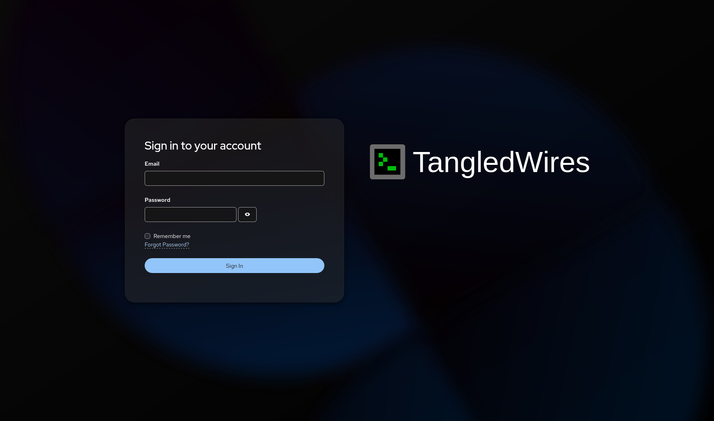

# TangledWires Keycloak Theme



# Testing the theme locally

[Documentation](https://docs.keycloakify.dev/testing-your-theme)

# How to customize the theme

[Documentation](https://docs.keycloakify.dev/css-customization)

# Building the theme

You need to have [Maven](https://maven.apache.org/) installed to build the theme (Maven >= 3.1.1, Java >= 7).  
The `mvn` command must be in the $PATH.

-   On macOS: `brew install maven`
-   On Debian/Ubuntu: `sudo apt-get install maven`
-   On Windows: `choco install openjdk` and `choco install maven` (Or download from [here](https://maven.apache.org/download.cgi))

```bash
npm run build-keycloak-theme
```

Note that by default Keycloakify generates multiple .jar files for different versions of Keycloak.  
You can customize this behavior, see documentation [here](https://docs.keycloakify.dev/features/compiler-options/keycloakversiontargets).

# Initializing the account theme

```bash
npx keycloakify initialize-account-theme
```

# Initializing the email theme

```bash
npx keycloakify initialize-email-theme
```
